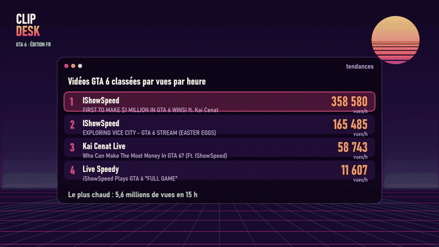

<div align="center">


<p>


</p>

**Les plus gros streamers font n'importe quoi sur GTA 6. Claude trouve le moment, tu postes la version française.**

<sub>Projet de fan non officiel. Aucun lien avec Rockstar Games, Take-Two ou Anthropic.</sub>

</div>

<p align="center"><a href="docs/demo.mp4"></a><br><sub>Cliquer pour voir la démo complète</sub></p>

## Installation

Dans Claude Code :

```
/plugin marketplace add Camille06000/gtavi-stream-money
/plugin install gtavi-claudecode-fr@gtavi-claudecode-fr
```

Il te faut Python 3.10 ou plus récent et ffmpeg. Le skill `installation` s'occupe du reste : il crée un environnement Python isolé (`.venv`) dans le dossier de ta page, sans jamais toucher à ton Python global.

## Premier lancement : colle ça dans Claude Code

```
Utilise gtavi-claudecode-fr. Installe ma page de clips GTA 6, pose-moi tes 4 questions en un seul message,
puis après un seul « oui » : trouve les campagnes de clipping ouvertes, montre-moi les vidéos et les lives
GTA 6 qui cartonnent, trouve les meilleurs moments du plus gros, découpe mes 3 premiers clips sous-titrés
en français avec une accroche, vérifie-les contre les règles de la campagne et dis-moi quoi poster où.
```

## La stratégie qui marche en français

Les lives qui font des millions de vues sont américains : IShowSpeed, Kai Cenat, xQc… Le public francophone les regarde, mais **les pages GTA en français sont beaucoup moins nombreuses**. Le plugin prend le moment le plus fou d'un live anglophone et en fait un clip vertical **sous-titré en français**, mise en page réaction comprise (le streamer en haut, le jeu en bas).

> Clippe un streamer seulement si sa campagne de clipping est ouverte ou s'il t'a donné son accord, et crédite-le toujours dans la légende (`🎥 @créateur`).

## Comment on gagne de l'argent avec

1. **Les campagnes de clipping (le plus rapide).** Des streamers et des marques paient les clippeurs **pour 1 000 vues validées** (Whop Content Rewards, Clip.tech…). Chaque campagne affiche son taux, son budget restant et ses règles. Le skill `campagnes` les lit en direct et n'invente jamais un chiffre.
2. **Ta propre page GTA 6 (plus lent, plus gros).** Les plateformes ne paient pas les clips repostés : la page grandit grâce à la vitesse, aux astuces utiles et aux clips crédités, puis rapporte via les campagnes et les partenariats.

Aucun revenu n'est promis. Le tableau des scores (`suivi-resultats`) te montre ce qui marche avec tes vrais chiffres.

## Ce qu'il y a dedans

| Skill | Ce que tu obtiens |
|---|---|
| `installation` | Vérifie Python et ffmpeg, crée le `.venv` de la page, pose 4 questions, prépare le dossier de ta page |
| `campagnes` | Campagnes de clipping ouvertes : taux pour 1 000 vues, budget restant, règles, lien |
| `tendances` | Vidéos GTA 6 des dernières 24 h classées par vues par heure |
| `streams-live` | Qui streame GTA 6 en ce moment, classé par spectateurs (filtre `--lang fr` sur Twitch) |
| `meilleurs-moments` | Les meilleurs passages de 15 à 40 s : pics de volume, mots d'excitation (français et anglais), passages les plus revus, pics du chat |
| `mode-live` | Enregistre un live et découpe un clip à chaque fois que le chat s'emballe |
| `reaction-twitch` | Clips réaction : visage du streamer en haut, jeu en bas, gros titre au milieu |
| `decoupe-clip` | Clip 1080×1920 : sous-titres mot à mot, accroche, son à -14 LUFS. `--translate fr` pour sous-titrer en français |
| `accroches` | 3 accroches et titres de réaction en français par clip |
| `verif-regles` | Durée, format, hashtags, mention et termes interdits vérifiés avant de poster |
| `multilangue` | Un clip en plusieurs langues, français par défaut, voix de synthèse en option |
| `questions-en-posts` | Les questions qui reviennent (Reddit, tes commentaires) deviennent des posts « COMMENT … DANS GTA 6 » |
| `carte-secrets` | Base des lieux cachés, voitures rares et easter eggs, avec horodatage et crédit |
| `codes-triche` | Les codes de triche signalés, avec sources, en carrousel de 4 slides |
| `routine` | Ta routine quotidienne complète et le plan du jour de sortie |
| `suivi-resultats` | Tableau des scores, un test par jour, gains à partir des vrais chiffres uniquement |
| `pilote-auto` | Pilote automatique (à activer toi-même) : live → clips FR → vérification → publication, puis live suivant |

## La règle absolue : Claude prépare, tu publies

Claude ne publie, ne programme, ne répond, ne commente et n'envoie **rien** à ta place, même si Buffer, un outil de publication ou ton navigateur sont connectés. Chaque post, réponse ou message te revient avec son fichier, sa légende et son crédit : tu dis « oui », et c'est toi qui publies.

**Exception, si tu l'actives toi-même : le pilote automatique.** Le skill `pilote-auto` regarde un gros live anglophone, découpe les meilleurs moments en clips sous-titrés en français, les vérifie et les publie sur YouTube Shorts, Instagram Reels et TikTok par les **API officielles**, puis passe au live suivant. Il démarre en mode `test` (rien n'est publié) ; c'est toi qui branches tes comptes ([guide pas à pas](docs/API-OFFICIELLES.md)) et qui passes `mode` à `auto` dans `pilote.json`. Garde-fous : plafond par jour et par plateforme, crédit obligatoire, `verif-regles` obligatoire, jamais de Reddit, de commentaire ni de message, un fichier `PAUSE` dans le dossier arrête tout.

Interdits : fuites, « jouer en avance », piratage, argent ou bots AFK de GTA Online, fausses infos, se faire passer pour Rockstar. Chaque fait doit avoir une source officielle.

## Twitch (optionnel)

YouTube marche sans clé. Pour la liste des streams Twitch, crée une application gratuite sur [dev.twitch.tv/console](https://dev.twitch.tv/console), puis écris toi-même tes clés dans le fichier `.env` du dossier de ta page :

```
TWITCH_CLIENT_ID=ton_client_id
TWITCH_CLIENT_SECRET=ton_secret
```

Ne colle jamais tes clés dans le chat. La lecture du chat Twitch en `mode-live` marche sans clé (lecture seule, anonyme).

## Ce qui change par rapport à l'original

Cette édition est une adaptation de [gtavi-claudecode](https://github.com/Bodila51/gtavi-claudecode) de Bodila51 (licence MIT). Le code d'origine (commit `dd95d39`) a été audité ligne par ligne avant l'adaptation : aucun code malveillant. Les changements :

- **Tout en français** : skills, guide quotidien, accroches, sorties des scripts, détection des questions et des mots d'excitation, masquage des injures.
- **Sous-titres français sur les clips réaction**, traduits par Claude (`--export-sentences` puis `--translations`, argot compris) ou automatiquement (`--translate fr`, une seule requête par clip), et français par défaut dans `multilangue`.
- **Jamais de publication automatique** : le guide d'origine poussait Claude à publier et répondre seul ; ici, tout passe par ton « oui ».
- **Installation sans surprise** : environnement `.venv` par page, versions encadrées, plus de mise à jour forcée chaque semaine, ffmpeg installé seulement avec ton accord.
- **API Twitch officielle** (Helix) à la place de l'API interne de Twitch ; Kick retiré (API interne).
- Corrections : accents et emojis sur la console Windows, chemins cassés de deux skills, crédit vide et plantage des clips réaction dans `translate.py`.

## Lancer les scripts toi-même

Depuis le dossier de ta page, avec le Python du venv (`.venv\Scripts\python.exe` sous Windows, `.venv/bin/python` ailleurs), en remplaçant `scripts/` par le chemin du plugin :

```
python scripts/trends.py --query "gta 6" --hours 24
python scripts/streams.py --query "gta 6" --lang fr
python scripts/moments.py "https://www.youtube.com/watch?v=..." --top 8
python scripts/cut.py jobs/<id> --pick 2 --export-sentences        # puis Claude traduit les phrases
python scripts/cut.py jobs/<id> --pick 2 --layout react --title "Speed a CRAQUÉ en plein braquage" --translations clip_2_fr.txt
python scripts/check.py jobs/<id>/edits/clip_2.mp4 --campaign campagnes.md --caption "… 🎥 @IShowSpeed"
python scripts/live.py "https://twitch.tv/<pseudo>" --minutes 60
```

Windows, macOS ou Linux. Une carte NVIDIA accélère la transcription ; sur le processeur, 12 minutes de vidéo prennent environ 5 minutes.

## Crédits et licence

- Projet d'origine : [Bodila51/gtavi-claudecode](https://github.com/Bodila51/gtavi-claudecode), licence MIT.
- Adaptation française : contributeurs de gtavi-claudecode-fr, licence MIT (voir [LICENSE](LICENSE)).
- Grand Theft Auto, GTA et Rockstar Games sont des marques de leurs propriétaires. Ce dépôt ne contient aucun fichier, logo ni visuel de Rockstar Games : l'identité visuelle « coucher de soleil néon » est originale.
